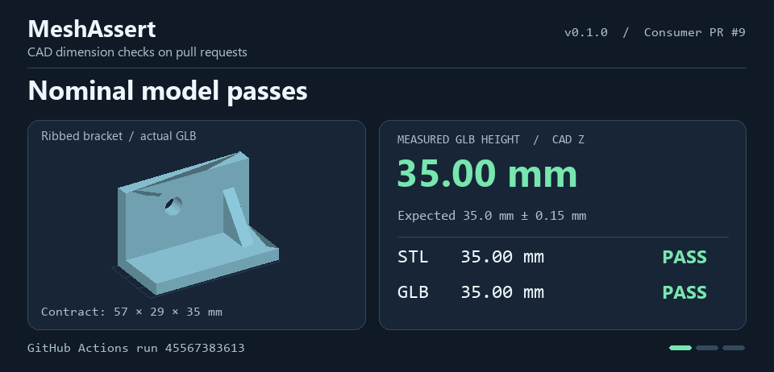

# MeshAssert

[English](README.md) · [简体中文](README.zh-CN.md)

[](https://github.com/LeeJUNhao791/meshassert/actions/workflows/ci.yml)
[](https://github.com/LeeJUNhao791/meshassert/releases/latest)
[](LICENSE)

Check the overall width, depth, and height of a manufacturing STL and its preview GLB against one CAD dimension contract.

[](https://github.com/LeeJUNhao791/glb-dimension-check/pull/9)

[Passing JSON report](docs/evidence/ribbed-bracket-pass.json) · [Failing JSON report](docs/evidence/ribbed-bracket-fail.json)

## Run the included examples

Use Python and Node.js on your PATH. Verified with Python 3.11.4 and Node.js 22.14.0. The checkers are included and the commands run offline.

```sh
python meshassert.py --expect fixtures/mounting-plate/expected.json --stl fixtures/mounting-plate/mounting_plate.stl --stl-unit mm --glb fixtures/mounting-plate/mounting_plate.glb
python meshassert.py --expect fixtures/ribbed-bracket/expected.json --stl fixtures/ribbed-bracket/ribbed_bracket.stl --stl-unit mm --glb fixtures/ribbed-bracket/ribbed_bracket.glb
```

| Fixture | CAD X × Y × Z | Tolerance per axis |
| --- | --- | --- |
| MP-001 Rev A mounting plate | 64 × 40 × 6 mm | ±0.20 mm |
| RB-001 Rev A ribbed bracket | 57 × 29 × 35 mm | ±0.15 mm |

To check your own files, see [Check your STL and GLB exports](docs/check-your-exports.md).

To run these checks on pull requests, see the [GitHub Actions guide](docs/github-actions.md).

For the optional local, read-only MCP stdio tool, see [Codex setup and the real-product CAD trial](docs/mcp.md). The CLI above does not require the MCP dependency.

## Inputs and outputs

The UTF-8 contract specifies CAD-axis spans in millimetres. Each value must be a finite, nonnegative JSON number. The shared `tolerance_mm` defaults to 0.1 mm when omitted.

```json
{
  "expected_mm": {"x": 64, "y": 40, "z": 6},
  "tolerance_mm": 0.2
}
```

STL uses the CAD Z-up frame and takes an explicit `--stl-unit mm` or `--stl-unit m`. GLB uses Y-up coordinates in metres. MeshAssert reports STL X/Y/Z and GLB X/Z/Y as CAD X/Y/Z in millimetres. The sign flip from CAD +Y to GLB −Z leaves the span unchanged.

The check measures the three axis-aligned outer spans. Verify hole sizes and positions, cutouts, mirroring, and mesh topology separately.

A passing report confirms only those digital dimensions; it does not certify a manufactured part.

After parsing the command-line arguments, MeshAssert prints one JSON report on stdout. It contains `status`, `contract`, `axis_frame` and both entries in `assets`. With a valid contract it also reports `expected_mm` and `tolerance_mm`. Each asset includes its path in `file`, `role`, `coordinate_unit`, `source_axes` and `status`. A measured asset adds `dimensions_mm`, signed `deviation_mm` (actual minus expected), `within_tolerance` and `out_of_tolerance_axes`. An invalid asset reports an `error`. A contract error makes both assets invalid and adds a top-level `error`.

| Exit code | JSON status | Result |
| --- | --- | --- |
| 0 | `pass` | Both assets meet the contract |
| 1 | `fail` | At least one asset is out of tolerance and both could be measured |
| 2 | `invalid` | An input or checker error takes precedence over a mismatch |

With a valid contract the other asset still gets its own result when one asset is invalid. A command-line syntax error exits 2 and prints usage to stderr.

## Verify the fixtures

```sh
python verify.py
```

The script runs nine cases twice, covering both nominal pairs, each out-of-tolerance export, malformed assets and a malformed contract. It checks the exit codes, asset results and repeatability of the JSON output.

## Contributing

See [CONTRIBUTING.md](CONTRIBUTING.md) for the verification command, scope, and bug-report details.

## Sources and notices

- The mounting-plate pilot supplied the MeshAssert adapter and exported assets. Its [drawing](fixtures/mounting-plate/drawing.svg), [contract](fixtures/mounting-plate/expected.json) and [CAD source](fixtures/mounting-plate/mounting_plate.py) trace to the GLB Dimension Check [mounting-plate example at `217f678459c5ec3395ce30d0dd1afd8dc1e3a7f1`](https://github.com/LeeJUNhao791/glb-dimension-check/tree/217f678459c5ec3395ce30d0dd1afd8dc1e3a7f1/examples/mesh-guard-mounting-plate). The directory includes the original [STEP](fixtures/mounting-plate/mounting_plate.step) and the pilot's [export script](fixtures/mounting-plate/regenerate.py).
- The ribbed-bracket [contract](fixtures/ribbed-bracket/expected.json), [CAD source](fixtures/ribbed-bracket/ribbed_bracket.py), [STEP](fixtures/ribbed-bracket/ribbed_bracket.step) and mesh exports come from the GLB Dimension Check [ribbed-bracket example at `4b957e835e8285912211c14a5cb0deccfc616d8f`](https://github.com/LeeJUNhao791/glb-dimension-check/tree/4b957e835e8285912211c14a5cb0deccfc616d8f/examples/meshassert-ribbed-bracket). Its taller GLB control raises the upright from 35 to 37 mm.
- The Mesh Guard measurement module and STL CLI come from the [`811a795e0f382cde7e89a2c887b292aec64d4529` revision](https://github.com/LeeJUNhao791/mesh-guard/tree/811a795e0f382cde7e89a2c887b292aec64d4529) and retain the [original MIT notice](checkers/mesh-guard/LICENSE).
- The GLB checker comes from the [`18ceb7485c43fde4f16a3ac1b394dfd29a9db105` revision](https://github.com/LeeJUNhao791/glb-dimension-check/tree/18ceb7485c43fde4f16a3ac1b394dfd29a9db105) and retains the [original MIT notice](checkers/glb-dimension-check/LICENSE), also present at the two GLB Dimension Check example revisions above.

## License

The project code and CAD examples are available under the [MIT License](LICENSE). The bundled checkers retain the notices listed above.
