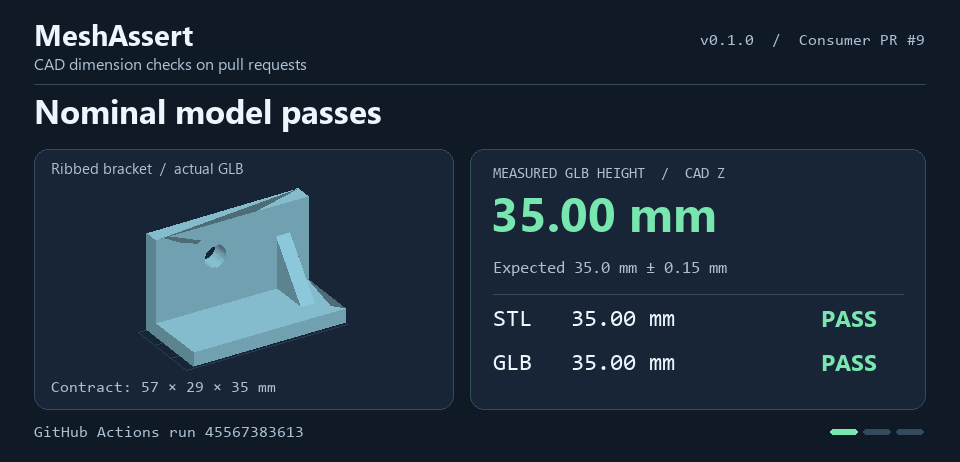

# MeshAssert

[English](README.md) · [简体中文](README.zh-CN.md)

[](https://github.com/LeeJUNhao791/meshassert/actions/workflows/ci.yml)
[](https://github.com/LeeJUNhao791/meshassert/releases/latest)
[](LICENSE)

用同一份 CAD 尺寸约定，检查用于制造的 STL 及其预览 GLB 的整体宽度、深度和高度。

[](https://github.com/LeeJUNhao791/glb-dimension-check/pull/9)

[通过的 JSON 报告](docs/evidence/ribbed-bracket-pass.json) · [未通过的 JSON 报告](docs/evidence/ribbed-bracket-fail.json)

## 运行内置示例

确保 Python 和 Node.js 在 PATH 中可用。已验证的版本为 Python 3.11.4 和 Node.js 22.14.0。检查器随仓库提供，以下命令可离线运行。

```sh
python meshassert.py --expect fixtures/mounting-plate/expected.json --stl fixtures/mounting-plate/mounting_plate.stl --stl-unit mm --glb fixtures/mounting-plate/mounting_plate.glb
python meshassert.py --expect fixtures/ribbed-bracket/expected.json --stl fixtures/ribbed-bracket/ribbed_bracket.stl --stl-unit mm --glb fixtures/ribbed-bracket/ribbed_bracket.glb
```

| 示例 | CAD X × Y × Z | 每轴公差 |
| --- | --- | --- |
| MP-001 Rev A 安装板 | 64 × 40 × 6 mm | ±0.20 mm |
| RB-001 Rev A 加筋支架 | 57 × 29 × 35 mm | ±0.15 mm |

检查自己的文件，请参阅[检查 STL 和 GLB 导出文件](docs/check-your-exports.md)（英文）。

在拉取请求中运行检查，请参阅 [GitHub Actions 指南](docs/github-actions.md)（英文）。

可选的本地只读 MCP stdio 工具，请参阅 [MCP 配置与试用](docs/mcp.zh-CN.md)。以上命令行检查无需安装 MCP 依赖。

## 输入和输出

UTF-8 编码的尺寸约定以毫米指定 CAD 各轴的整体跨度。每个值必须是有限、非负的 JSON 数字。共用的 `tolerance_mm` 在省略时默认为 0.1 mm。

```json
{
  "expected_mm": {"x": 64, "y": 40, "z": 6},
  "tolerance_mm": 0.2
}
```

STL 使用 CAD 的 Z 向上坐标系，必须通过 `--stl-unit mm` 或 `--stl-unit m` 明确指定单位。GLB 使用 Y 向上坐标系，单位为米。MeshAssert 将 STL 的 X/Y/Z 和 GLB 的 X/Z/Y 对应到 CAD X/Y/Z，并以毫米报告。CAD +Y 对应 GLB −Z 的方向反转不会改变跨度。

检查只测量沿三个坐标轴的整体外尺寸。孔径、孔位、开口、镜像和网格拓扑需要另外验证。

报告通过只确认这些数字模型尺寸，不代表实物制造合格认证。

解析命令行参数后，MeshAssert 在标准输出打印一份 JSON 报告，其中包含 `status`、`contract`、`axis_frame` 和 `assets` 中的两个文件结果。尺寸约定有效时，还会报告 `expected_mm` 和 `tolerance_mm`。每个文件结果包含路径 `file`、`role`、`coordinate_unit`、`source_axes` 和 `status`。可测量的文件还包含 `dimensions_mm`、带正负号的 `deviation_mm`（实测值减去期望值）、`within_tolerance` 和 `out_of_tolerance_axes`。无效文件会报告 `error`。尺寸约定出错时，两个文件都会标记为无效，并增加顶层 `error`。

| 退出码 | JSON 状态 | 结果 |
| --- | --- | --- |
| 0 | `pass` | 两个文件均满足尺寸约定 |
| 1 | `fail` | 两个文件均可测量，至少一个文件超差 |
| 2 | `invalid` | 输入或检查器出错，优先于尺寸不匹配 |

尺寸约定有效时，即使一个文件无效，另一个文件仍会得到自己的结果。命令行语法错误时退出码为 2，用法说明写入标准错误。

## 验证示例

```sh
python verify.py
```

脚本将九种情况各运行两次，覆盖两组正常导出、各个超差导出、损坏文件和损坏的尺寸约定。它检查退出码、各文件结果以及 JSON 输出的可重复性。

## 参与贡献

验证命令、范围和缺陷报告要求见 [CONTRIBUTING.md](CONTRIBUTING.md)（英文）。

## 来源与声明

- 安装板试点提供了 MeshAssert 适配器和导出文件。其[图纸](fixtures/mounting-plate/drawing.svg)、[尺寸约定](fixtures/mounting-plate/expected.json)和 [CAD 源码](fixtures/mounting-plate/mounting_plate.py)来自 GLB Dimension Check 的[安装板示例，版本为 `217f678459c5ec3395ce30d0dd1afd8dc1e3a7f1`](https://github.com/LeeJUNhao791/glb-dimension-check/tree/217f678459c5ec3395ce30d0dd1afd8dc1e3a7f1/examples/mesh-guard-mounting-plate)。目录还保留原始 [STEP](fixtures/mounting-plate/mounting_plate.step) 和试点的[导出脚本](fixtures/mounting-plate/regenerate.py)。
- 加筋支架的[尺寸约定](fixtures/ribbed-bracket/expected.json)、[CAD 源码](fixtures/ribbed-bracket/ribbed_bracket.py)、[STEP](fixtures/ribbed-bracket/ribbed_bracket.step) 和网格导出文件来自 GLB Dimension Check 的[加筋支架示例，版本为 `4b957e835e8285912211c14a5cb0deccfc616d8f`](https://github.com/LeeJUNhao791/glb-dimension-check/tree/4b957e835e8285912211c14a5cb0deccfc616d8f/examples/meshassert-ribbed-bracket)。其中用于对照的较高 GLB 将竖直部分从 35 mm 增加到 37 mm。
- Mesh Guard 的测量模块和 STL 命令行程序来自 [`811a795e0f382cde7e89a2c887b292aec64d4529` 版本](https://github.com/LeeJUNhao791/mesh-guard/tree/811a795e0f382cde7e89a2c887b292aec64d4529)，保留[原始 MIT 声明](checkers/mesh-guard/LICENSE)。
- GLB 检查器来自 [`18ceb7485c43fde4f16a3ac1b394dfd29a9db105` 版本](https://github.com/LeeJUNhao791/glb-dimension-check/tree/18ceb7485c43fde4f16a3ac1b394dfd29a9db105)，保留[原始 MIT 声明](checkers/glb-dimension-check/LICENSE)；该声明也存在于上述两个 GLB Dimension Check 示例版本中。

## 许可证

项目代码和 CAD 示例采用 [MIT 许可证](LICENSE)。内置检查器保留上面列出的声明。
